  
  
  

###

  

###

<h1 data-importer="text" align="center">Olá! Seja bem-vindo!👋</h1>

###

<h3 data-importer="text" align="left">👩‍💻  Sobre mim:</h3>

###

Eu sou de SP e me chamo Niko  - 🔭 A procura de oportunidades - 📚 Aprendendo Figma, HTML, CSS e Java Script - ⚡ No tempo livre eu jogo vídeo games e prático escrita criativa

###

<h3 data-importer="text" align="left">🛠 Linguagens e ferramentas</h3>

###

  
  
  
  
  
  
  

###

<picture data-importer="pacman">
  <source media="(prefers-color-scheme: dark)" srcset="https://raw.githubusercontent.com/Nikocode-dev/Nikocode-dev/pacman-output/galaga-contribution-graph-dark.svg?game=galaga">
  <source media="(prefers-color-scheme: light)" srcset="https://raw.githubusercontent.com/Nikocode-dev/Nikocode-dev/pacman-output/galaga-contribution-graph.svg?game=galaga">
  
</picture>

###
